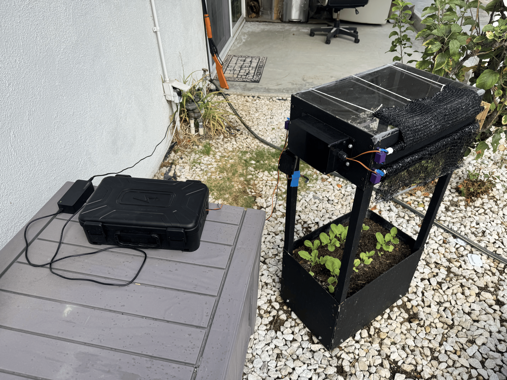
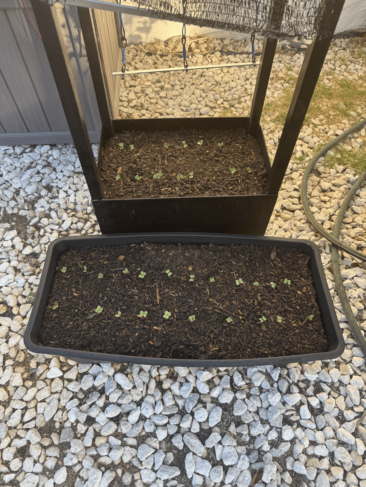
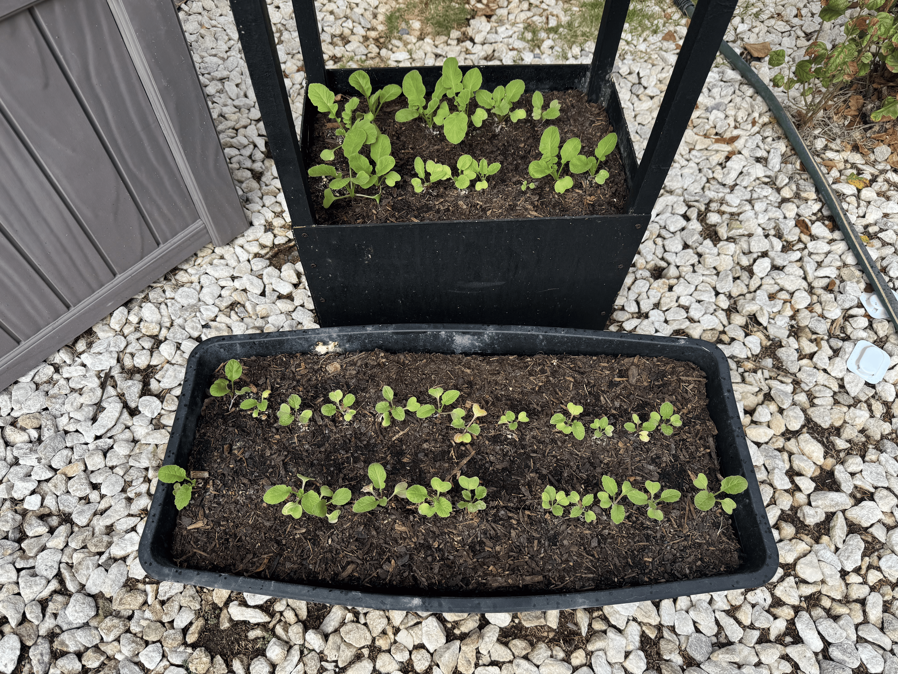

# Plant Light Controller


This repository contains the firmware for an ESP32-based plant-light and shade
controller. It reads ambient light, moves three shades, and uses a plant's
light target and daily schedule to select a shade position. Wi-Fi provides
time synchronization; WeatherAPI provides forecast data when available.
Bluetooth is used for setup and status.

## What it does

- Reads a BH1750 light sensor and estimates photosynthetic photon flux density
  (PPFD) from lux.
- Tracks daily light integral (DLI), the accumulated light received during the
  configured photoperiod.
- Tests the available combinations of three shades and selects a position
  based on measured light and the plant's target.
- Opens and closes the shades on a schedule and can accept a manual
  optimization request.
- Uses a weather forecast and location to estimate remaining daylight DLI.
  If a forecast is unavailable, the controller can still optimize using its
  plant PPFD target.
- Exposes configuration and live controller status over Bluetooth Low Energy
  (BLE).

This is an operating project prototype. The BH1750 lux-to-PPFD conversion and 
the weather-derived sunlight estimate are approximations, not laboratory
measurements or horticultural advice.

## Operating sequence

On startup, the firmware loads the last saved plant, controller settings, and
DLI progress from ESP32 Preferences, then starts BLE advertising so the
website can configure the device. Once required settings are present, it
connects to Wi-Fi, synchronizes its clock with NTP, checks the light sensor,
and attempts to retrieve forecast data. During the configured photoperiod it
tracks DLI and runs scheduled optimization scans. Outside the photoperiod it
stops scans and closes the shades.

An optimization scan visits each of the eight combinations of three open or
closed shades. After each movement finishes, the firmware waits for the
reading to settle, measures light, scores that state against the target, then
applies the best-scoring state. The main loop continues servicing BLE,
network reconnection, and servo motion while a scan advances. When a shade
state requires multiple servos, their starts are staggered by 200 ms to reduce
simultaneous startup current. Failed scans are retried after a 60-second
backoff, while manual optimization requests remain available. A failed sensor
reading aborts that scan for a later retry; it does not turn the controller's
approximate measurements into guaranteed plant-light levels.

## How the firmware is organized

`src/main.cpp` creates the system components and runs the main loop. The loop
keeps network, BLE, and servo updates responsive, then moves through setup,
Wi-Fi, time synchronization, initial sensor/weather checks, and normal
operation. Light scans and servo movement advance over repeated loop
iterations rather than holding the processor in long movement delays.

The main modules are under `lib/`:

| Module | Responsibility |
| --- | --- |
| `Plant` | Stores the plant profile, DLI range, and photoperiod; calculates a target DLI and corresponding average PPFD. |
| `LightSensor` | Initializes the BH1750 over I2C and converts lux to approximate PPFD using `lux / 54`. |
| `DLITracker` | Integrates PPFD over elapsed time (`PPFD × seconds / 1,000,000`) and periodically saves progress. |
| `LightController` | Runs a non-blocking sweep of the eight possible three-shade states, measures PPFD after movement settles, scores each state against the target, then applies the selected state. |
| `ServoController` | Runs the three servos with individually configurable open/close durations, tracks movement and shade state, and saves settings. Timed movement is calibrated by duration, not position feedback. |
| `TimeManager` | Gets time from NTP, applies the configured POSIX time-zone rule, checks the photoperiod, and schedules/retries optimizations. |
| `WeatherForecast` | Requests hourly cloud information from WeatherAPI and estimates sunlight/DLI using a clear-sky model adjusted for cloud cover. |
| `NetworkManager` | Connects and reconnects to Wi-Fi without blocking the main loop. |
| `SettingsManager` | Loads and saves Wi-Fi, API, location, start-time, and time-zone settings. |
| `AppCommunication` | Hosts the BLE service, reads/writes JSON configuration, and reports plant, servo, Wi-Fi, time-sync, weather, and controller status. |

Plant settings, Wi-Fi settings, servo timings, and schedule information are
stored in ESP32 Preferences (non-volatile storage), so they normally survive a
restart. Complete setup currently requires Wi-Fi credentials, a WeatherAPI
key, a non-zero location, a plant profile, synchronized time, and a successful
initial forecast request before light optimization can start. If that request
fails, the controller retries the weather request and waits instead of
optimizing with only the plant PPFD target. Light optimization is limited to
the configured photoperiod; the controller closes shades after that period.

## Hardware and wiring

The project configuration targets an **ESP32 DOIT DevKit V1**. The current pin
assignments in `include/Pins.h` are listed below.

| Component | Purpose |
| --- | --- |
| ESP32 DOIT DevKit V1 | Runs the firmware and hosts the BLE connection. |
| BH1750 light sensor | Measures ambient illuminance over I2C. |
| Three hobby servos | Move the top, left, and right shades independently. |
| Regulated power supply | Provides the current required by the ESP32 and servos. |

The pin assignments are:

| Device | ESP32 connection |
| --- | --- |
| BH1750 SDA | GPIO 21 |
| BH1750 SCL | GPIO 18 |
| Top shade servo signal | GPIO 25 |
| Left shade servo signal | GPIO 26 |
| Right shade servo signal | GPIO 27 |

Connect sensor power and ground according to the sensor board's voltage
specification: the BH1750 is fully compatible with the ESP32's 3.3 volt supply.
Connect each servo's signal wire to its assigned GPIO. Servos usually require
around 5 volts, more than the ESP32 board's 3.3 volt supply: split the 5 volt power
supply among the ESP32 and servos and connect the servos' ground to ESP32 ground.
Do not power the servos from an ESP32 GPIO. Check the voltage and wiring of your
particular boards before powering the assembly. Use proper gauges for the signal
and power lines. See my [full wiring diagrams](images/wiring/diagram/) as physical
sketches or my [physical wiring](images/wiring/physical) for the final build.

The controller uses timed servo movement. Set and test the open and close
durations for the actual shade mechanics before unattended use.

Before connecting power, verify each component's voltage requirements, wire
polarity, and common ground. Test one servo at a time with the shade mechanism
unloaded, then calibrate open and close durations and check for binding. A
timed servo has no position feedback, so a commanded movement does not confirm
that a shade reached its end position.

## Build and upload to the ESP32

### VS Code and PlatformIO

1. Install [Visual Studio Code](https://code.visualstudio.com/) and the
   **PlatformIO IDE** extension.
2. Open this repository's folder, `Plant-Light-Controller`, in VS Code.
3. Connect the ESP32 to the computer with a USB data cable.
4. In `platformio.ini`, change `upload_port = COM3` to the COM port assigned to
   your ESP32, if it is different. On Windows, check **Device Manager → Ports
   (COM & LPT)**.
5. Build the project using PlatformIO's **Build** command. PlatformIO reads
   `platformio.ini` and installs the listed framework and libraries as
   needed.
6. Use PlatformIO's **Upload** command to flash the firmware.
7. Open the PlatformIO serial monitor at **115200 baud** to view startup,
   connection, and sensor messages.

The configured PlatformIO environment is `esp32doit-devkit-v1`, using the
Arduino framework. The declared libraries are BH1750, ESP32Servo, and
ArduinoJson. If the board does not upload, verify the selected COM port and
follow the board's boot/upload instructions.

With the PlatformIO CLI installed, the equivalent commands from this
repository's folder are:

```text
pio run
pio run -t upload
pio device monitor -b 115200
```

## How the two repositories connect

The firmware and the `Plant-Box-App` website are separate parts of the
project. The website selects a plant and prepares configuration; this firmware
receives that configuration over BLE. The ESP32 advertises as
`Smart_Plant_Shade` and uses a custom GATT service and characteristic. The
website and firmware must use the same UUIDs:

- Service: `3ffb09d6-6ba2-4d32-bc92-cbdaf9798ffa`
- Characteristic: `0dddf571-257c-4021-964b-a6fd9212384f`

The characteristic supports reads, writes, and notifications. The website
writes JSON in small BLE chunks; the firmware collects the chunks, parses the
completed JSON, and saves accepted settings. The website reads JSON status
including plant details, shade states, servo timings, time synchronization,
photoperiod, and optimization progress. Keep the two UUID definitions and the
JSON field names/array layout in sync when changing the protocol.

## Configuration and troubleshooting

- The first setup requires Wi-Fi credentials, a WeatherAPI key, location,
  time-zone rule, photoperiod start, and a plant profile. The website supplies
  these values over BLE; verify the reported settings before relying on
  scheduled operation.
- The serial monitor reports BLE setup, Wi-Fi reconnects, NTP status, sensor
  reads, weather request results, and optimization steps.
- If the sensor is not detected, check its power, I2C wiring, and the
  configured SDA/SCL pins.
- If a servo does not complete its movement, check the external supply,
  common ground, mechanical load, and calibrated movement duration.
- If the BLE device is not visible, confirm the ESP32 has power, restart the
  website's connection flow, and disconnect another BLE client already using
  the controller.
- If the controller remains in setup, reconnect with the website and confirm
  that the plant, Wi-Fi, API key, location, time zone, and schedule were sent.
- If scheduled operation does not start, confirm configuration, Wi-Fi, NTP
  time, and that the current time is inside the photoperiod.
- Keep Wi-Fi passwords and API keys out of source control and public logs.

## Testing and results
### Experiment


- Both groups: 2 rows of radishes planted 1/2 inches deep spaced 2 inches
  apart with the rows 4 inches apart.
- Control group (grown in a regular plant-box): 1.5 cubic feet, 2.1 square square 
  feet, 3 initial gallons of water
- Experimental group (grown with my custom box): 1.4 cubic feet, 1.5 square feet,
  2 initial gallons of water
- For the first 8 days:
  - Control group: 7.1 cups 3 times per week (total 1.3 gallons per week)
  - Experimental group: 5 cups 3 times per week (total 0.91 gallons per week)
  - See the [image of growth](images/experiment/Schedule_Change_Comparison.png) until the end of this period

- For the next 19 days (in order to prevent dryness and pests):
  - Both groups: A bit of food grade diatomaceous earth at the base of each sapling
  - Control group: 3.05 cups daily (total 1.3 gallons per week)
  - Experimental group: 2.15 cups daily (total 0.91 gallongs per week)
  - See the [image of growth](images/experiment/Near_Final_Comparison.png) in the middle of this period

### Results

As seen in the image, the radishes in the experimental group in my custom box (despite
some being accidentaly planted closer together) grew much more and much larger compared
to the control group. Despite the small experimental groups due to the limited scale of
the prototype, I have high confidence in these results since I personally ensured that
every part of their growth other than the presence or lack thereof of the box were strictly
identical. This shows the success of my box in increasing growth efficiency by controlling
the sunlight received which is what it set out to do.
